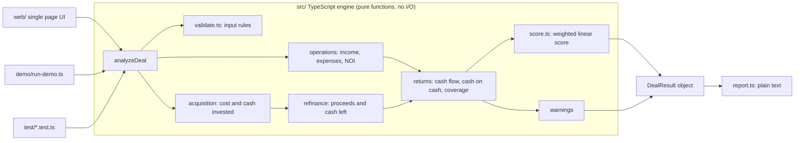

# brrr-deal-analyzer

**Before you buy a fixer-upper rental, see whether it will pay for itself after the refinance and how much of your cash stays stuck in it.**

**Live demo:** https://brrr-deal-analyzer.vercel.app (runs in the browser, no login)

For rental investors who buy, rehab, rent, then refinance (BRRR). A quick spreadsheet tends to skip bridge loan points and interest, holding costs, rehab contingency and refinance closing costs. Type in one deal and this shows:

- **Monthly cash flow** after the new loan payment, with every expense line.
- **Cash back at refinance** and how much is still left in the deal.
- **A 0 to 100 score** where each point is explained: value measured, floor, target, points.
- **Warnings and a stress test**: what happens if rent is 10 percent low, the rate is a point higher, the appraisal is 10 percent low or the rehab runs 20 percent over.

The tooling: a TypeScript calculation engine with no runtime dependencies, 27 unit tests, a single page web UI and a command line demo, all checked in CI. Everything runs offline on numbers you type in.

**Not financial advice.** This is a calculator with fixed, simplified assumptions. It does not know your market, your lender or your tax position, and nothing it prints is a recommendation to buy, sell or finance anything. Check every number with qualified professionals before acting.

## What you will see

Real output from `npm run demo` for the second of three invented sample deals (full capture in [`demo/output.txt`](demo/output.txt), which CI compares against a fresh run):

```text
=== Sample Bungalow B (invented numbers) ===
  Cash invested..................... $58,640
  Cash left in the deal............. $20,840
  Cash flow......................... $170 per month
  Cash on cash return............... 9.8%
  Debt service coverage............. 1.20
Score: 58.3 of 100 (workable)
Stress test
  Scenario                          Cash flow   DSCR  Cash left  Score  Verdict
  Base case                              $170   1.20    $20,840   58.3  workable
  Rent 10 percent lower                   $36   1.04    $20,840   21.0  pass
  Refinance rate 1 point higher           $86   1.09    $20,840   34.4  pass
  Appraisal 10 percent lower             $254   1.34    $32,840   68.2  workable
  Rehab 20 percent over budget           $170   1.20    $26,780   52.1  marginal
```

The excerpt skips the lines between the ones shown. A deal that looks workable turns into a pass if rent comes in 10 percent low. The appraisal row scores higher because the loan is smaller, while $12,000 more cash stays in the deal; see Limitations.

## What it does

You give it purchase, bridge loan, rehab, holding, rent, expense and refinance inputs. It returns:

- **Project cost and cash invested**: purchase, closing, rehab with contingency, bridge points and interest, holding costs.
- **Refinance outcome**: new loan, net proceeds after paying off the bridge loan, cash left in the deal, percent of cash recovered, equity.
- **Monthly operations**: effective income after vacancy, each expense line, net operating income, debt service, cash flow.
- **Returns**: cash on cash return, debt service coverage ratio, cap rate, rent to cost, all in cost to value.
- **A transparent score** from 0 to 100. Five components, each linear between a floor (zero points) and a target (full points). Every component reports its measured value, floor, target, points and a note.
- **Warnings** for negative cash flow, weak coverage, a refinance that cannot pay off the bridge loan, cost above value, zero contingency and zero vacancy.
- **A stress test** that reruns the deal with lower rent, a higher rate, a lower appraisal and a rehab overrun.

### Score components (defaults)

| Component | Floor | Target | Max points |
| --- | --- | --- | --- |
| Monthly cash flow | 0 | 300 | 25 |
| Cash on cash return | 0% | 12% | 25 |
| Debt service coverage | 1.0 | 1.4 | 25 |
| Cash recovered at refinance | 50% | 100% | 15 |
| Equity after refinance | 15% | 30% | 10 |

Verdicts: 75 and up is `strong`, 55 and up is `workable`, 35 and up is `marginal`, below that is `pass`. All of these live in one config object (`DEFAULT_SCORE_CONFIG` in `src/score.ts`) and `analyzeDeal` accepts a replacement.

## Architecture



The engine has no dependencies and does no I/O. The UI, the demo and the tests all call the same `analyzeDeal` function and render the same result object.

## Run it

```bash
npm install
npm start
```

Then open http://localhost:4173. Set `PORT` in the environment to use another port. No keys, accounts or network access are needed.

The hosted demo is the same page as a static site: `npm run build:static` writes `web/` plus the compiled engine to `public/`, and `vercel.json` tells Vercel to run that build and serve that folder.

## Tests

```bash
npm test
```

This compiles the TypeScript and runs 27 unit tests with the Node built in test runner. The core test deal uses round numbers so every figure can be checked by hand. CI (`.github/workflows/ci.yml`) runs the tests and the demo on Node 20, 22 and 24, and fails if the demo output differs from `demo/output.txt`.

## Demo

```bash
npm run demo
```

The demo analyzes three invented deals (one strong, one workable, one to pass on), prints a full report and stress test for each, then ranks them. It runs offline. The score lines for the first deal:

```text
Score: 89.4 of 100 (strong)
  Monthly cash flow             25.0 / 25  value 368.22 per month, floor 0, target 300 (at or above target)
  Cash on cash return           25.0 / 25  value 91.11 percent, floor 0, target 12 (at or above target)
  Debt service coverage         23.1 / 25  value 1.37 ratio, floor 1, target 1.4 (between floor and target)
  Cash recovered at refinance    9.6 / 15  value 82.04 percent, floor 50, target 100 (between floor and target)
  Equity after refinance         6.7 / 10  value 25 percent of value, floor 15, target 30 (between floor and target)
```

## Use the engine from code

After `npm run build`, from a script in the repository root:

```js
import { analyzeDeal, SAMPLE_DEALS } from "./dist/src/index.js";

const result = analyzeDeal(SAMPLE_DEALS[0]);
console.log(result.monthly.cashFlow, result.returns.dscr, result.score.total); // 368.22 1.37 89.4
```

## Where this pattern runs

The pattern here (a pure calculation engine, a result object that explains itself, and thin front ends on top) is drawn from systems that run two small service companies day to day. This repository is a clean, standalone version with invented data only.

## Limitations

- **No integrations and no live data.** Nothing here calls a listing, rent estimate, interest rate or lender service, so nothing is mocked and nothing has been run against one. Every input is a number you type in, and the three sample deals are invented.
- **Simplified loan model.** The bridge loan is interest only and treated as fully drawn on day one, so interest is slightly overstated when rehab funds are drawn in stages. The refinance is a single fixed rate, fully amortizing loan.
- **One stabilized year.** No rent growth, expense inflation, appreciation, loan paydown, or multi year projection. No internal rate of return.
- **No taxes.** Income tax, depreciation and transfer taxes are not modeled.
- **No seasoning or lender rules.** The refinance uses the loan to value you enter. Real lenders may cap the loan at cost, require a waiting period, or set a minimum coverage ratio. The 1.2 coverage warning is a common rule of thumb, not any lender's actual policy.
- **The score is a convention, not a truth.** Floors, targets and weights are opinions that suit small rentals in lower priced markets. A deal in a high priced market can be sound and still score poorly. Change the config to fit your own criteria.
- **Part of the score just restates your inputs.** Equity after refinance is always 100 minus the loan to value you enter, and it trades off directly against cash recovered. The cash flow target is per property, not per unit, so a duplex and a single unit are held to the same 300 a month.
- **The stress test is one change at a time.** It does not combine a low rent with a high rate. The rehab overrun is applied to the budget before contingency, and the bridge loan is assumed to fund its usual share of the overrun, which many lenders will not do.
- **A lower appraisal can raise the score.** A smaller refinance loan means a lower payment and better coverage, while more cash stays in the deal. The stress test shows both effects; read the cash left column, not only the score.
- **Cash on cash is undefined when no cash is left in the deal.** The engine reports that case as an infinite return (or not applicable when cash flow is not positive) instead of a number.
- **Inputs are trusted.** The engine checks ranges, but it cannot tell you whether your rent, rehab or value estimates are realistic. Those estimates drive everything.
- **Single currency, no locale handling.** Amounts print with a dollar sign.
- **The web UI has no automated tests.** The engine is unit tested; the page was checked by hand in one desktop browser. The hosted demo is this same page built by Vercel, with no monitoring or uptime promise.

License: MIT, see the LICENSE file.
